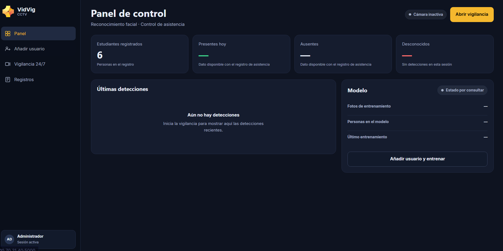
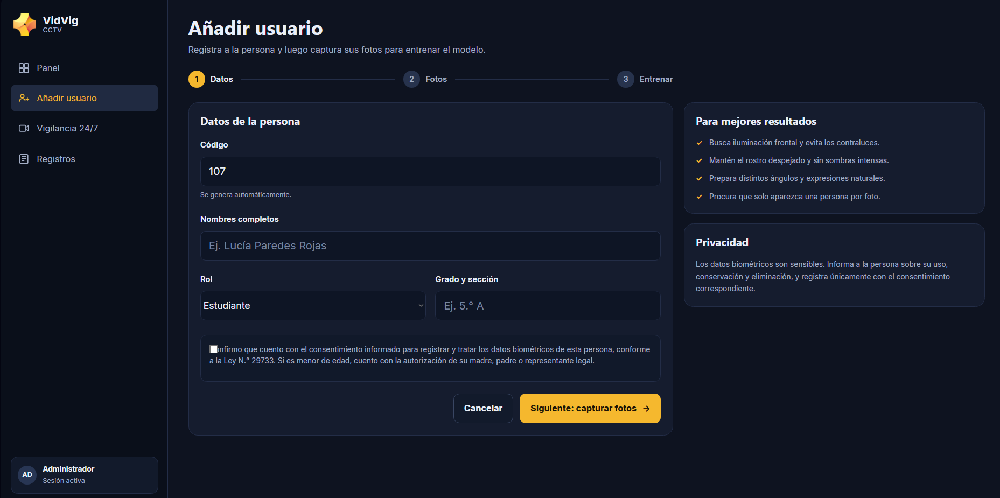
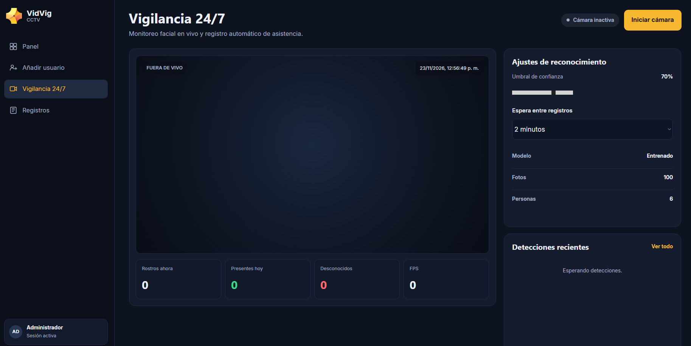
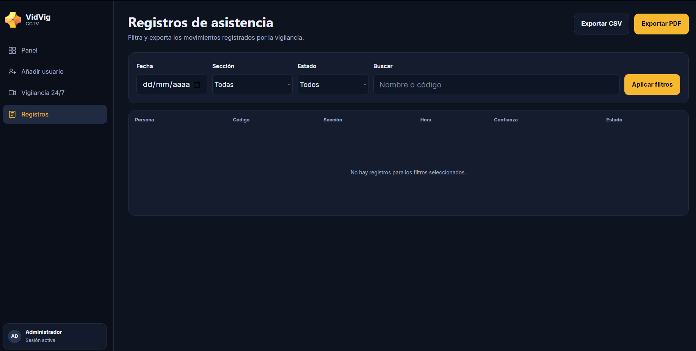

# VidVig CCTV — Sistema de Reconocimiento Facial y Control de Asistencia

Aplicación web de monitoreo en tiempo real y control automatizado de asistencia mediante visión por computadora. Permite registrar estudiantes o personal, capturar conjuntos de imágenes faciales para entrenar un modelo local de reconocimiento, supervisar transmisiones en vivo con umbral de confianza configurable y exportar reportes de asistencia en CSV y PDF.

---

## Características principales

* **Panel de control en tiempo real:** Indicadores de estudiantes registrados, presentes del día, ausentes, detecciones de personas desconocidas y estado del modelo entrenado.
* **Flujo guiado de registro biométrico (3 pasos):** Alta de usuarios con código autogenerado, captura secuencial de rostro y entrenamiento del modelo con validación de consentimiento informado conforme a la **Ley N.° 29733** (Protección de Datos Personales).
* **Vigilancia 24/7:** Transmisión en vivo con ajuste dinámico del umbral de confianza (%), intervalo de espera entre registros para evitar duplicados y métricas de FPS y rostros detectados.
* **Auditoría y exportación de registros:** Filtrado por fecha, grado/sección, estado o búsqueda por nombre/código, con descarga directa en **CSV** y **PDF**.

---

## Capturas del sistema

### Panel de control


### Registro de usuario y entrenamiento


### Módulo de vigilancia en vivo


### Historial y exportación de asistencia


---

## Stack tecnológico

* **Backend:** Python, Flask
* **Visión por computadora:** OpenCV (clasificadores Haar Cascade / LBPH)
* **Frontend:** HTML5, CSS3 (interfaz oscura personalizada), JavaScript Vanilla
* **Persistencia:** SQL / SQLite

---

## Estructura del proyecto

```text
modelo-entrenamiento-estudiantes/
├── docs/                                # Capturas de interfaz para documentación
├── modelo_entrenamiento_estudiantes/    # Código fuente de la aplicación
│   ├── app.py                           # Servidor Flask y rutas de API / video streaming
│   ├── db.sql                           # Esquema de base de datos (usuarios y asistencia)
│   ├── classifier.xml                   # Modelo entrenado de reconocimiento facial
│   ├── static/                          # Hojas de estilo (vidvig.css) y scripts (captura.js)
│   └── templates/                       # Vistas HTML (panel, registro, vigilancia, registros)
└── .gitignore
